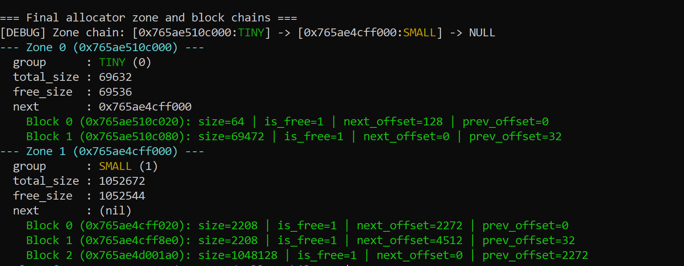
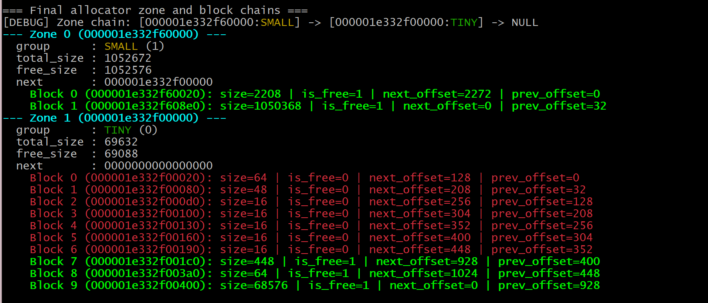
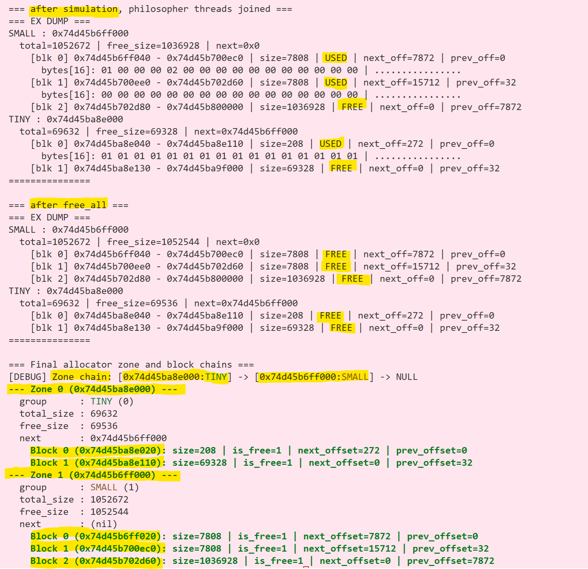
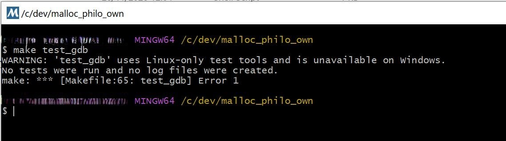

# Philosophers with a custom allocator

Experimental C systems project pairing a multi-threaded Dining Philosophers simulation with a custom dynamic memory allocator across Linux/WSL and Windows 10 (MinGW64), built to showcase low-level memory management.

## Build and run

**Linux/WSL + Windows 10**:

```sh
make
./philo/philo 5 800 200 200 2

make malloc
make philo-malloc
./philo/philo_malloc 5 800 200 200 2
```

## Tests

Run individual tests from the repository root:

- `make philo-test`(**Linux/WSL + Windows 10**): Philo integration smoke tests linked to the custom allocator.
- `make allocator-test`(**Linux/WSL only**): allocator unit and multithreaded tests (Linux).
- `make philo-memory-test` (**Linux/WSL + Windows 10**): prints allocator snapshots before and after the simulation, then prints the final zone and block chains. Override the simulation arguments with `PHILO_ARGS`. It disables stdout buffering before initialization and uses a write-based helper for its own checkpoint labels, so the diagnostic does not add a stdio output buffer to the allocator snapshots. 

For example (**Linux/WSL + Windows 10**):

  ```sh
  make philo-memory-test PHILO_ARGS="195 800 200 200 2"
  ```

### Memory Management Across Linux/WSL and Windows 10

While the custom allocator (`TINY`/`SMALL`/`LARGE` zones, 16-byte alignment, and `free_size` accounting) behaves consistently across both platforms, exact block layouts can differ between Linux/WSL and Windows 10 (MinGW64):

- **Runtime startup allocations:** On Windows, the C runtime (`CRT`/MinGW) may allocate dynamic memory before `main()`—such as building `argv` strings from the command line—which appears in the `TINY` zone alongside `philo` allocations and remains `USED` after `free_all()` because it is owned by the runtime rather than the simulation. On Linux, `argv` is prepared on the stack by the kernel prior to entry.
- **Platform-specific primitives & sizing:** Differences in thread/synchronization primitives and OS-level memory/threading layouts can shift allocation sizes or zone placement (for instance, fork/mutex structures landing in `TINY` vs. `SMALL`), while zone headers, offsets, and free-block totals remain consistent.

```sh
make philo-memory-test PHILO_ARGS="195 800 200 200 2"
```

**Linux/WSL:**


**Windows 10:**


Run it directly first. Piping to `tee` creates a log file even if compilation fails.



- `make sani` (**Linux/WSL only**): ThreadSanitizer check.

**ThreadSanitizer environment warning**

> In this WSL2/GCC 11 environment, ThreadSanitizer can fail before producing a race report: it may print `FATAL: ThreadSanitizer: unexpected memory mapping` or terminate with `Segmentation fault (core dumped)`. A trivial empty program compiled with the same sanitizer also fails here, indicating a TSan runtime/environment problem rather than a Philo diagnostic. The `sani` target disables core dumps.

- `make valgrind` (**Linux/WSL only**): Valgrind check of the regular Philo
  executable.


**Valgrind timing**

Valgrind slows the multithreaded simulation. The current Valgrind command uses 17 philosophers with a 250 ms time-to-die and 250 ms eating and sleeping times. A philosopher dying in this run is expected: the death deadline is as short as the eating interval, and instrumentation adds scheduling overhead.
That simulation result alone is not a memory error. Check Valgrind's `HEAP SUMMARY` and `ERROR SUMMARY` for leaks and memory errors.

- `make strace` (**Linux/WSL only**): traces `mmap`/`munmap` calls made by the
  custom-allocator executable, displays them, and saves the trace to
  `philo/obj/philo_malloc.strace`.


- `make test_gdb` (**Linux/WSL only**): runs only `sani`, `valgrind`, and
  `strace`. It writes `test/sani.log`, `test/valgrind.log`, and
  `test/strace.log`. All three run even if one fails; the target returns
  failure if any test fails. Logs are overwritten on each run.

Windows 10 output:



Linux/WSL output:


## Platforms

The regular Philo and custom-allocator builds support Linux and Windows (MSYS2/MinGW-w64 with GCC, GNU Make, and winpthreads). The allocator uses `mmap`/`munmap` on Linux and `VirtualAlloc`/`VirtualFree` on Windows. Philo uses `clock_gettime`/`nanosleep` on Linux and `GetTickCount64`/`Sleep` on Windows. Valgrind, strace, ThreadSanitizer, and the allocator's standalone test harness are Linux/POSIX tools. Windows sleep timing has coarser granularity, so simulation timings may differ.

In the MSYS2 MINGW64 terminal, `make`, `make philo-malloc`,
`make philo-test`, and `make philo-memory-test` build or run the Windows
versions of the programs.

On native Windows, `allocator-test`, `sani`, `valgrind`, `strace`, and
`test_gdb` print a warning and stop before building or running Linux-only
tools. They do not create test logs. Run these diagnostics in Linux or WSL.

`make clean` removes object files. `make fclean` also removes generated binaries, libraries, and the three `test_gdb` logs.

**Linux/WSL**: 

```bash
login@...:~/42_repos/malloc_philo_own$ ./philo/philo 5 800 200 200 2
1 1 is thinking
1 2 is thinking
2 3 is thinking
2 1 has taken a fork
2 2 has taken a fork
2 2 has taken a fork
3 2 is eating
3 4 is thinking
4 5 is thinking
4 4 has taken a fork
...
806 3 has taken a fork
807 4 is sleeping
807 5 is thinking
807 3 is eating
808 5 has taken a fork
808 5 has taken a fork
809 5 is eating
809 1 is sleeping
1008 3 is sleeping
1010 5 is sleeping
no one died today
login@...:~/42_repos/malloc_philo_own$ 
```

**Windows 10**:

```bash
login@... MINGW64 /c/dev/malloc_philo_own
$ ./philo/philo.exe 5 800 200 200 2
16 1 is thinking
32 1 has taken a fork
32 1 has taken a fork
32 2 is thinking
47 3 is thinking
47 1 is eating
63 4 is thinking
63 3 has taken a fork
63 3 has taken a fork
79 3 is eating
...
954 2 has taken a fork
969 2 is eating
985 4 is thinking
985 3 is sleeping
1000 4 has taken a fork
1032 4 has taken a fork
1063 4 is eating
1063 5 is sleeping
1204 2 is sleeping
1282 4 is sleeping
no one died today
login@... MINGW64 /c/dev/malloc_philo_own
```

## AI Usage Disclosure

To keep authorship and workflow transparency clear across the repository, here is how AI tools were used:

- **Gemini:** Used for theory only; no code was generated.
- **ChatGPT:** Used strictly for drafting and formatting function documentation.
- **GitHub Copilot:** Used to implement malloc compatibility, integrate it with the Philo program, add Linux and Windows compatibility, and assist with testing.
- **Kimi AI/Claude AI:** Not used.
