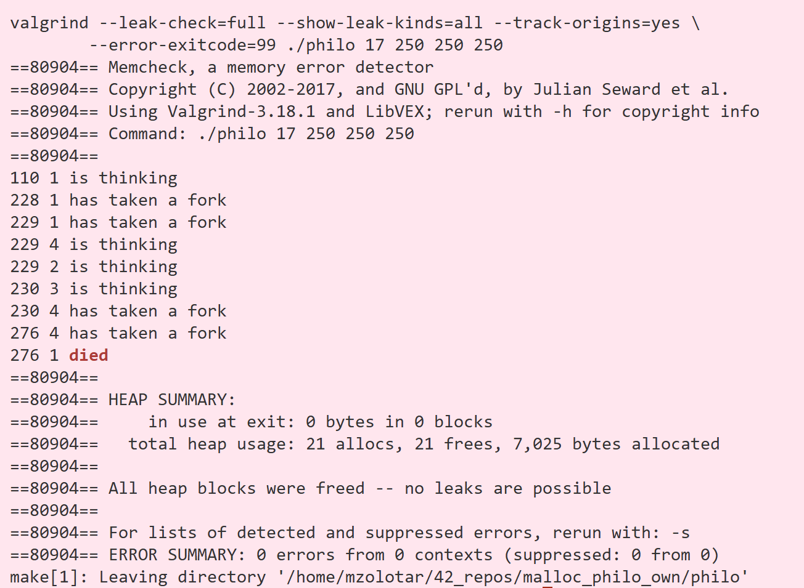
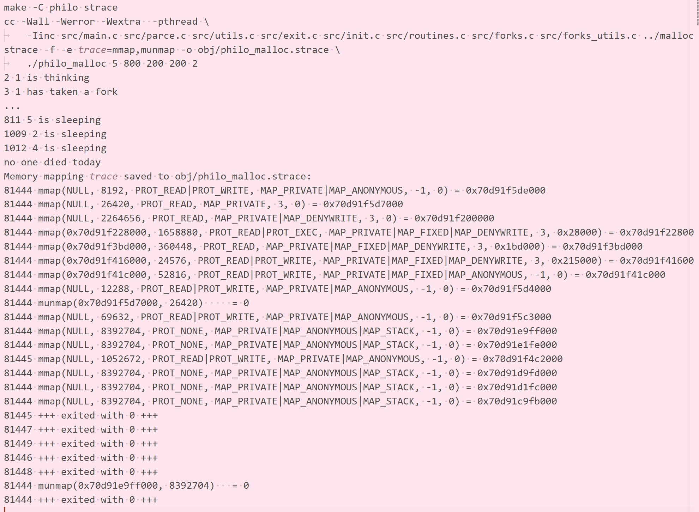

# Philosophers with a custom allocator

 to do


## Build and run

```sh
make
./philo/philo 5 800 200 200 2

make malloc
make philo-malloc
./philo/philo_malloc 5 800 200 200 2
```

## Tests

Run individual tests from the repository root:

- `make philo-test`: Philo integration smoke tests linked to the custom allocator.
- `make allocator-test`: allocator unit and multithreaded tests (Linux).
- `make philo-memory-test`: prints allocator snapshots before and after the simulation, then prints the final zone and block chains. Override the simulation arguments with `PHILO_ARGS`. It disables stdout buffering before initialization and uses a write-based helper for its own checkpoint labels, so the diagnostic does not add a stdio output buffer to the allocator snapshots. For example:

  ```sh
  make philo-memory-test PHILO_ARGS="195 800 200 200 2" | tee philo-memory.log
  ```


- `make sani`: ThreadSanitizer check.

**ThreadSanitizer environment warning**

> In this WSL2/GCC 11 environment, ThreadSanitizer can fail before producing a race report: it may print `FATAL: ThreadSanitizer: unexpected memory mapping` or terminate with `Segmentation fault (core dumped)`. A trivial empty program compiled with the same sanitizer also fails here, indicating a TSan runtime/environment problem rather than a Philo diagnostic. The `sani` target disables core dumps.

- `make valgrind`: Valgrind check of the regular Philo executable.



**Valgrind timing**

Valgrind slows the multithreaded simulation. The current Valgrind command uses 17 philosophers with a 250 ms time-to-die and 250 ms eating and sleeping times. A philosopher dying in this run is expected: the death deadline is as short as the eating interval, and instrumentation adds scheduling overhead.
That simulation result alone is not a memory error. Check Valgrind's `HEAP SUMMARY` and `ERROR SUMMARY` for leaks and memory errors.


- `make strace`: traces `mmap`/`munmap` calls made by the custom-allocator executable, displays them, and saves the trace to `philo/obj/philo_malloc.strace`.



- `make test_gdb`: runs only `sani`, `valgrind`, and `strace`. It writes `test/sani.log`, `test/valgrind.log`, and `test/strace.log`. All three run even if one fails; the target returns failure if any test fails. Logs are overwritten on each run.


## Platforms

The regular Philo and custom-allocator builds support Linux and Windows (MSYS2/MinGW-w64 with GCC, GNU Make, and winpthreads). The allocator uses `mmap`/`munmap` on Linux and `VirtualAlloc`/`VirtualFree` on Windows. Philo uses `clock_gettime`/`nanosleep` on Linux and `GetTickCount64`/`Sleep` on Windows. Valgrind, strace, ThreadSanitizer, and the allocator's standalone test harness are Linux/POSIX tools. Windows sleep timing has coarser granularity, so simulation timings may differ.

`make clean` removes object files. `make fclean` also removes generated binaries, libraries, and the three `test_gdb` logs.

## AI Usage Disclosure

To keep authorship and workflow transparency clear across the repository, here is how AI tools were used:

- **Gemini:** Used for theory only; no code was generated.
- **ChatGPT:** Used strictly for drafting and formatting function documentation.
- **GitHub Copilot:** Used to implement malloc compatibility, integrate it with the Philo program, add Linux and Windows compatibility, and assist with testing.
- **Kimi AI/Claude AI:** Not used.
